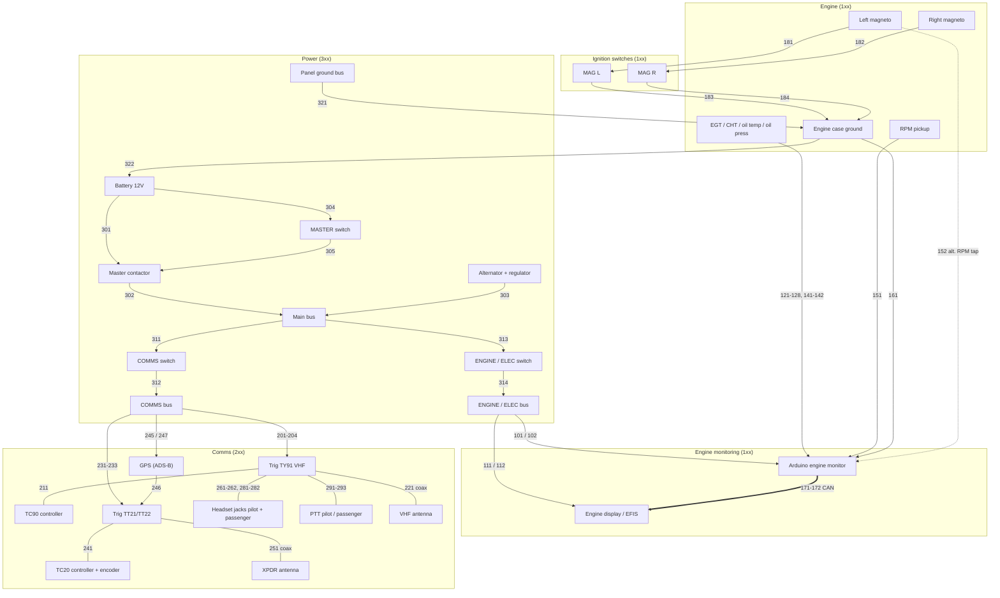
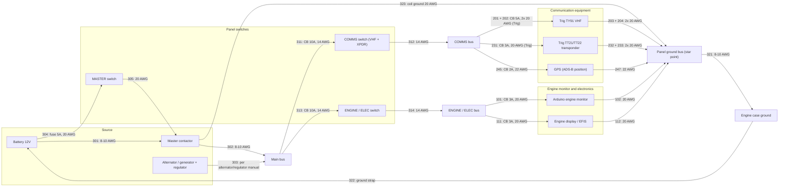
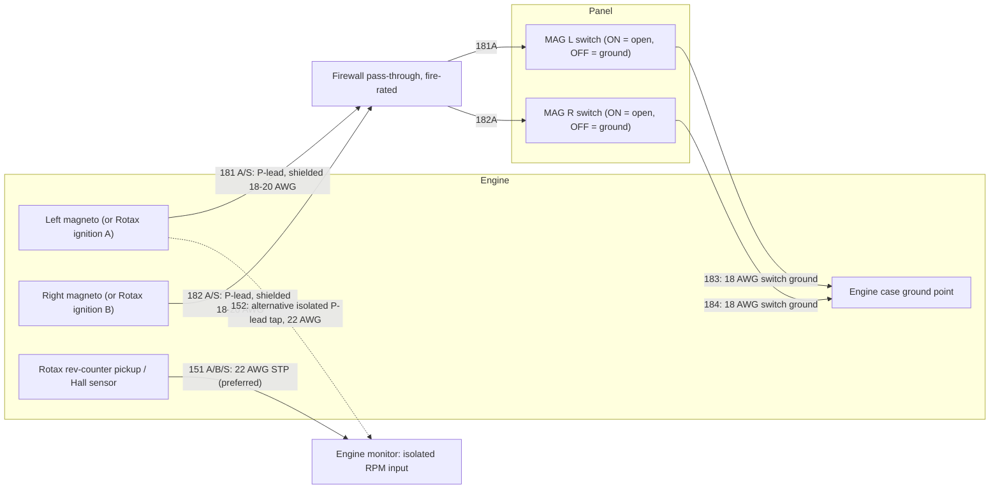
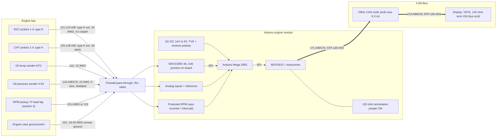
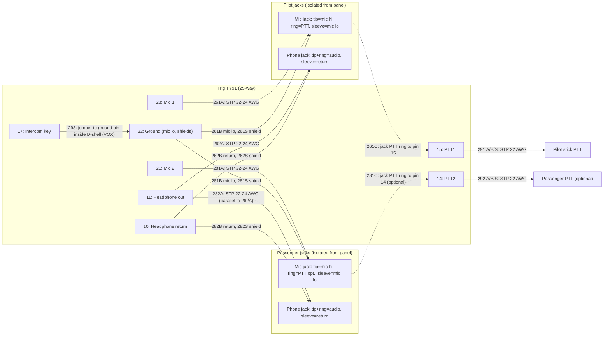
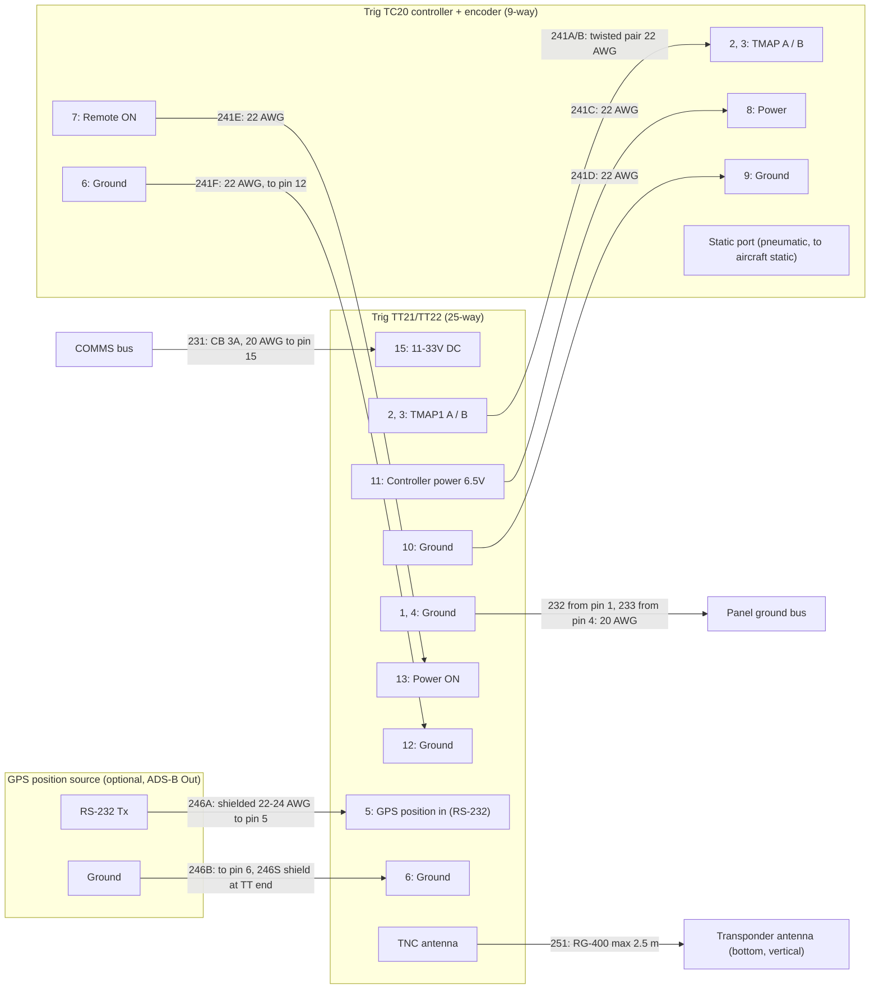

# 00009. Reference Wiring Diagram for Generic Panel Setup

2026-11-16

## Status

__New__

## Context

ADR-0008 defines wire types, gauges, shielding and routing rules, but gives no
picture of how a complete installation fits together. Builders need a
reference diagram showing how the engine monitor shares power, ground and
panel space with the minimum avionics of a light experimental aircraft, plus
the ignition (magneto) wiring that the engine monitor taps for RPM.

Reference equipment:
- Arduino-based engine monitor node (sensor inputs, CAN-Bus output) and a
  CAN display node.
- VHF radio: Trig TY91 remote unit with TC90 panel controller (display),
  built-in 2-place intercom. Installation manual 00839-00 issue AH:
  https://trig-avionics.com/library/00839-00-AH%20TY91%20and%20TY92%20Installation%20Manual.pdf
- Transponder: Trig TT21 or TT22 remote unit with TC20 panel controller
  (display). The TC20 contains the altitude encoder (static port on the TC20),
  so no separate encoder is needed. Installation manual 00560-00 issue AQ:
  https://trig-avionics.com/library/00560-00%20AQ%20TT21TT22%20Installation%20Manual.pdf
- The manuals are copyrighted and not stored in git. Download them into
  `docs/manuals/` (ignored by `.gitignore`) for local reference.
- Optional GPS position source for ADS-B Out (e.g. Trig TN72 or other
  supported RS-232 GPS).
- Two headsets (pilot and passenger).
- Two magnetos (or two Rotax ignition circuits) with separate ignition
  switches. No starter.

Power switching requirements:
- A master switch for the battery.
- A switch for the critical communication equipment (VHF and transponder).
- A separate switch for the engine monitor and other electronics.

The diagrams must be readable in the repository (Markdown rendered on
GitHub) and maintainable as text so they can be reviewed in pull requests.
Every wire needs a unique identifier so the diagram, the wire list, the labels
in the aircraft and troubleshooting notes all refer to the same thing.

Assumptions:
- 14 V DC electrical system, battery + alternator/generator with regulator.
- Engine monitor based on an Arduino-class microcontroller (e.g. Mega 2560)
  with MCP2515 CAN controller, MAX31855-class thermocouple converters and a
  DC-DC converter. The external wiring is identical for the Raspberry Pi
  variant from ADR-0001/ADR-0002.

## Decision

We document the reference installation with Mermaid diagrams and a wire list
in this ADR, and identify every wire with a numeric wire number. Gauges and
cable types follow ADR-0008, except where the Trig installation manuals give
specific values; those values are used and marked "(Trig)". The manuals
always take precedence for Trig equipment.

### 1. Wire numbering system

A wire number has the form `SNN[C]`:

- `S` - system group (first digit):

  | Group | System                                                       | Range   |
  | ----- | ------------------------------------------------------------ | ------- |
  | 1     | Engine systems (monitor, sensors, display, CAN-Bus, ignition) | 100-199 |
  | 2     | Communication (VHF, transponder, GPS, audio, antennas)       | 200-299 |
  | 3     | Power distribution, switching and grounding                  | 300-399 |
  | 4     | Lighting (reserved)                                          | 400-499 |
  | 5     | Flight instruments / EFIS (reserved)                         | 500-599 |
  | 6     | Fuel system (reserved)                                       | 600-699 |
  | 7-9   | Reserved                                                     | -       |

- `NN` - circuit number within the group. Sub-ranges keep related circuits
  together (see the allocation table). Gaps are intentional so circuits can
  be added later without renumbering.
- `C` - optional conductor letter for multi-conductor cables or harnesses:
  `A`, `B`, `C`, ... for the conductors, `S` for the shield/drain.
  Single-conductor wires have no letter. Example: `121A` = EGT 1 chromel (+),
  `121B` = EGT 1 alumel (-), `211A` = TC90 TMAP A.

Rules:
- A wire keeps its number through in-line connectors and the firewall
  pass-through. If a run is split into separately replaceable segments, append
  `-1`, `-2` from the source end (e.g. `121A-1`, `121A-2`).
- The power feed of a unit uses the number of the system the unit belongs to
  (the VHF feed is 2xx, not 3xx). 3xx is only for distribution and switching:
  battery, master, buses, bus switches, ground bus and ground straps.
- Each wire is marked at both ends (laser/ink-jet sleeve or heat-shrink
  label, not hot stamp on thin-wall wire, see ADR-0008) and within 3 inches of
  every connector or splice.
- The wire list (section 10) is the source of truth; diagrams show the numbers.
  Numbers are never reused after a wire is removed.

#### Allocation

| Range   | Use                                         |
| ------- | ------------------------------------------- |
| 101-109 | Engine monitor power and ground             |
| 111-119 | Engine display / EFIS power and ground      |
| 121-129 | Thermocouples (121-124 EGT, 125-128 CHT)    |
| 141-149 | Resistive and voltage senders (temp, press) |
| 151-159 | RPM pickups                                 |
| 161-169 | Sensor ground returns                       |
| 171-179 | CAN-Bus segments                            |
| 181-189 | Ignition: P-leads / kill wires, switch grounds |
| 201-209 | VHF (TY91) power and ground                 |
| 211-219 | VHF controller (TC90) interconnect          |
| 221-229 | VHF RF (coax)                               |
| 231-239 | Transponder (TT21/TT22) power and ground    |
| 241-244 | Transponder controller (TC20) interconnect  |
| 245-249 | GPS power, ground and data                  |
| 251-259 | Transponder RF (coax)                       |
| 261-279 | Audio pilot position                        |
| 281-289 | Audio passenger position                    |
| 291-299 | PTT and intercom key                        |
| 301-309 | Battery, master contactor, master switch, alternator |
| 311-319 | Switched buses (COMMS, ENGINE / ELEC)       |
| 321-339 | Ground bus and ground straps                |

### 2. System overview

All units and wire groups in one picture. Detail per subsystem follows in
sections 3-8; the wire list (section 10) has every conductor.

Ground returns (102, 112, 203-204, 232-233, 247, 323) all go to the panel
ground bus; they are left out of this overview for readability.

### 3. Power distribution and switching

Notes:
- No starter, so the main power cables (301, 302) are sized for the maximum
  alternator output plus margin rather than for starter current.
- MASTER switches the contactor coil. A small aircraft with a low total load
  may use a suitably rated master switch directly in the battery line instead
  of a contactor; then 304/305 disappear and 301/302 go through the switch.
- COMMS and ENGINE / ELEC are independent: an electrical fault on one bus can
  be isolated without losing the other. The ENGINE / ELEC switch can stay on
  while radios are switched off during start-up transients.
- Bus switches may be implemented as circuit-breaker switches (combined
  switch and breaker); then 311/313 have no separate breaker.
- Both TY91 power pins (24, 25) and at least two grounds must be wired; peak
  transmit current exceeds one connector pin's rating (Trig 5.6.11).
- The TT21/TT22 power input is NOT protected against reverse polarity;
  verify 231 polarity before first power-up (Trig 5.6.1).
- Breaker values protect the wire (ADR-0008 section 2, item 4).

### 4. Ignition (magnetos) and RPM

The ignition circuits are independent of the aircraft electrical system:
they must work with MASTER off and must not depend on any bus.

Rules:
- A magneto is LIVE when its P-lead is open. A broken P-lead, a loose switch
  terminal or a failed switch ground leaves the magneto live with the switch
  OFF. Do the magneto ground check (switch each magneto OFF briefly at idle
  and confirm the RPM drop / engine stumble) after every change to this
  wiring.
- Use separate switches for left and right; do not use a switch that can
  ground both through a single contact. A key switch without start position
  is an alternative.
- P-lead shield (181S, 182S) grounded at the magneto end; at the switch end
  the shield is trimmed back and insulated. If the magneto or ignition
  manufacturer prescribes a different scheme, follow the manufacturer.
- Switch grounds 183/184 run to the engine case ground point, not only to the
  panel ground bus, so the kill path does not depend on the airframe ground
  strap.
- RPM: use the dedicated pickup (151) where available (Rotax rev-counter
  output, Hall sensor). For magneto engines without a pickup, use tap 152 on
  ONE P-lead only, connected to the P-lead with an environmentally sealed
  splice near the switch, into the engine monitor's isolated, protected input
  (ADR-0008 section 6). The tap must never be able to ground the P-lead.
- Route P-leads away from audio, CAN and coax bundles; cross at 90 degrees.

### 5. Engine monitor detail: sensors and CAN-Bus

Notes:
- CAN conductors: `A` = CAN-H, `B` = CAN-L, `C` = CAN-GND, `S` = shield.
  Shield of 171/172 is grounded at one point only (ADR-0008 section 4).
- Thermocouple conductors: `A` = chromel (+, yellow), `B` = alumel (-, red).
- Oil pressure conductors: `A` = +5 V excitation, `B` = signal,
  `C` = sender return, `S` = shield.
- RPM conductors (151): `A` = signal, `B` = return, `S` = shield.
- Bus order: engine monitor (end, terminated) -> other nodes -> display (end,
  terminated). If the engine monitor is not at a bus end, its termination
  jumper is OFF. Check: about 60 ohm between 171A and 171B with power off.
- The Arduino Mega's on-board regulator is not suitable for direct 14 V
  aircraft power (heat at 14.4 V charging voltage, no transient protection).
  Use an external DC-DC converter with input TVS diode and reverse polarity
  protection.
- Rotax single-terminal senders use the engine case as return: wire 161 is
  mandatory (ADR-0008 section 5).
- The Trig TMAP bus (RS-485 based, VHF and transponder controllers) is a
  separate, point-to-point Trig link; it is not connected to the CAN-Bus.

### 6. VHF radio: Trig TY91 + TC90

TY91 connector: 25-way D-sub (Trig 5.5.1). TC90 connector: 15-way D-sub
(Trig 5.7.1). Crimp contacts accept 20-24 AWG.

```mermaid
flowchart LR
    CBUS["COMMS bus"]
    GND["Panel ground bus"]

    subgraph TY91["Trig TY91 (25-way)"]
        P24["24, 25: Aircraft power"]
        P19["19, 22: Ground"]
        P3["3, 4: TMAP1 A / B"]
        P12["12: Controller power 12V"]
        P13["13: Power ON"]
        P9["9: Ground"]
        RF["TNC antenna"]
    end

    subgraph TC90["Trig TC90 controller (15-way)"]
        C2["2, 3: TMAP A / B"]
        C9["9: Power in"]
        C10["10: Power ground"]
        C8["8: Remote ON"]
        C7["7: Ground"]
    end

    VANT["VHF comm antenna (ground plane >= 1 m2 on composite)"]

    CBUS -- "201 to pin 24, 202 to pin 25: CB 5A, 20 AWG" --> P24
    P19 -- "203 from pin 19, 204 from pin 22: 20 AWG" --> GND
    P3 -- "211A/B: twisted pair 22 AWG" --> C2
    P12 -- "211C: 22 AWG" --> C9
    P9 -- "211D: 22 AWG" --> C10
    C8 -- "211E: 22 AWG" --> P13
    C7 -- "211F: 22 AWG, to pin 9" --> P9
    RF -- "221: RG-400 / RG-142B, TNC" --> VANT
```

TC90 interconnect 211 (Trig 5.10.1):

| Cond. | TY91 pin        | TC90 pin        | Notes                          |
| ----- | --------------- | --------------- | ------------------------------ |
| 211A  | 3 TMAP1 A       | 2 TMAP A        | Twist with 211B, 1 turn / 1-2 in |
| 211B  | 4 TMAP1 B       | 3 TMAP B        |                                |
| 211C  | 12 Ctrl power   | 9 Power in      | NEVER connect to aircraft power |
| 211D  | 9 Ground        | 10 Power ground |                                |
| 211E  | 13 Power ON     | 8 Remote ON     | TC90 power switch turns TY91 on |
| 211F  | 9 Ground        | 7 Ground        | Return for 211E                |

- Max 211 length: 28 m at 20 AWG, 15.6 m at 22 AWG, 10 m at 24 AWG (TC90
  power line < 1 ohm, Trig 5.10.1).
- 211 may share a loom with the TC20 interconnect (241); audio and antenna
  wiring must be kept apart (Trig 5.10.1 note).
- Unused: pins 5, 6 (RS-232, not used), 7, 8 (TMAP2, for a second TC90),
  16 (reserved), 18 (TX interlock, dual VHF only), 20 (aux audio), 1, 2
  (speaker - add as 205/206 if a cabin speaker is fitted).
- Antenna: 221 RG-400 or RG-142B, 50 ohm (Trig 5.11.2); keep at least 2 ft
  from any GPS antenna and at least 3 ft from the transponder antenna.

### 7. Dual headset, PTT and intercom (TY91)

The TY91 has one headphone output (mono) intended for one or two 300-600 ohm
headsets in parallel, two microphone inputs with 12 V bias for standard
aviation headsets, two PTT inputs and an intercom key input (Trig 5.6).
Standard GA plugs: PJ-068 microphone (0.206 in), PJ-055 phone (0.25 in).

Conductor assignment:

| Wire | A                    | B                    | C                    | S                      |
| ---- | -------------------- | -------------------- | -------------------- | ---------------------- |
| 261  | Mic 1 hi, pin 23     | Mic lo, pin 22       | PTT ring, pin 15     | Shield, pin 22 (radio end only) |
| 262  | Phone, pin 11        | Return, pin 10       | -                    | Shield, radio end only |
| 281  | Mic 2 hi, pin 21     | Mic lo, pin 22       | PTT ring, pin 14 (opt.) | Shield, pin 22 (radio end only) |
| 282  | Phone, pin 11        | Return, pin 10       | -                    | Shield, radio end only |
| 291  | PTT1, pin 15         | Ground, pin 22/9     | -                    | Shield, radio end only |
| 292  | PTT2, pin 14 (opt.)  | Ground, pin 22/9     | -                    | Shield, radio end only |
| 293  | Intercom key pin 17 to ground (single wire, VOX intercom) | - | - | -     |

Rules:
- Mic and phone lines in screened twisted pair, screen grounded at the radio
  end only (Trig 5.6.10, 5.10.3, diagram 2 note 5). Unscreened audio picks
  up transponder replies as clicks in the headset.
- The TY91 has only five ground pins (1, 9, 10, 19, 22) for about ten ground
  connections; double up with a short ground jumper inside the D-shell
  (Trig 5.6.12).
- Phone output is mono: at each phone jack, connect tip and ring together to
  262A/282A so stereo headsets hear audio in both ears. 262 and 282 join at
  pin 11 / pin 10 at the radio connector.
- PTT1 (pilot) has priority over PTT2 (Trig 5.6.6).
- Intercom: 293 ties pin 17 to ground for voice-activated (VOX) intercom.
  For a switched intercom, replace 293 with a switch to ground and set VOX
  squelch to minimum (Trig 5.6.7).
- Mic lo and phone return are separate wires, joined only at the radio.
  Jacks are mounted with insulating washers, not grounded to the panel.
- The TY91 does not support dynamic microphones without a preamplifier.

### 8. Transponder: Trig TT21/TT22 + TC20, GPS

TT21/TT22 connector: 25-way D-sub (Trig 5.5.1). TC20 connector: 9-way D-sub
(Trig 5.7.1). Crimp contacts accept 20-24 AWG.

TC20 interconnect 241 (Trig 5.10):

| Cond. | TT21/TT22 pin   | TC20 pin   | Notes                            |
| ----- | --------------- | ---------- | -------------------------------- |
| 241A  | 2 TMAP1 A       | 2 TMAP A   | Twist with 241B, 1 turn / 1-2 in |
| 241B  | 3 TMAP1 B       | 3 TMAP B   |                                  |
| 241C  | 11 Ctrl power   | 8 Power    | 6.5 V; NEVER aircraft power      |
| 241D  | 10 Ground       | 9 Ground   |                                  |
| 241E  | 13 Power ON     | 7 Remote ON| TC20 mode knob turns TT on       |
| 241F  | 12 Ground       | 6 Ground   | Return for 241E                  |

- Max 241 length: 14.2 m at 20 AWG, 7.8 m at 22 AWG, 5.0 m at 24 AWG (TC20
  power line < 0.5 ohm, Trig 5.10).
- GPS: power 245 from the COMMS bus, ground 247, data 246 to TT pin 5/6.
  Set the GPS protocol and line speed in the transponder configuration
  (Trig 6.1.8, 6.1.9). Without GPS the transponder works as Mode S without
  ADS-B Out.
- Unused: pins 7 (TIS out, USA only), 8, 9 (TMAP2), 14 (ground spare),
  17 (external standby, dual transponder only), 18 (mutual suppression,
  only with DME/TCAS), 19 (squat switch: leave open and configure "ignore";
  with ADS-B the TT uses GPS for air/ground), 20 (remote ident, optional:
  add as 234 with a momentary switch to ground), 16, 21-25 reserved.
- TC20 pin 4 (altitude out, RS-232 9600 bps) is optional for GPS
  baro-aiding; add as 242 if used.
- TC20 static port connects to the same static source as the primary
  altimeter (Trig 5.12); this is a pneumatic line, not a wire.
- Antenna 251: 50 ohm, double braid or foil + braid, max 1.5 dB cable loss
  at 1090 MHz. RG-400 (M17/128) max about 2.5 m (8 ft 4 in); longer runs need
  lower-loss cable (Trig 5.11.2 table). Antenna on the bottom surface,
  vertical in level flight, at least 3 ft from the VHF comm antenna, with
  a ground plane of at least 120 mm square (700 mm square ideal) on
  composite or fabric airframes.

### 9. Bundles and routing

| Bundle                | Wires                                       | Keep away from               |
| --------------------- | ------------------------------------------- | ---------------------------- |
| Power feeders         | 101, 111, 201-202, 231, 245, 301-305, 311-314 | Audio, sensor wiring       |
| Grounds               | 102, 112, 203-204, 232-233, 247, 321-323    | -                            |
| Ignition              | 181-184, 152                                | Audio, CAN, coax, panel avionics |
| Engine sensor         | 121-128, 141-142, 151, 161                  | Ignition leads, 303 B-lead   |
| CAN-Bus               | 171-172                                     | 221, 251, ignition           |
| Trig controller loom  | 211, 241 (may share one loom, Trig 5.10.1)  | Audio                        |
| Audio                 | 261-262, 281-282, 291-293                   | 221, 251, ignition, alternator |
| GPS data              | 246                                         | 221                          |
| RF                    | 221, 251 (separately clamped)               | All other bundles            |

### 10. Wire list

| Wire | From                     | To                         | Cable / gauge                      | Protection |
| ---- | ------------------------ | -------------------------- | ---------------------------------- | ---------- |
| 101  | ENGINE/ELEC bus CB       | Engine monitor +14V        | 22759/16, 20 AWG                   | CB 3A      |
| 102  | Engine monitor GND       | Panel ground bus           | 22759/16, 20 AWG                   | -          |
| 111  | ENGINE/ELEC bus CB       | Display +14V               | 22759/16, 20 AWG                   | CB 3A      |
| 112  | Display GND              | Panel ground bus           | 22759/16, 20 AWG                   | -          |
| 121-124 | EGT probe 1-4         | Engine monitor TC in 1-4   | Type K ext., 20 AWG, A=+ B=-       | -          |
| 125-128 | CHT probe 1-4         | Engine monitor TC in 5-8   | Type K ext., 20 AWG, A=+ B=-       | -          |
| 141  | Oil temp sender          | Engine monitor analog in   | 22759/16, 22 AWG                   | -          |
| 142  | Oil pressure sender      | Engine monitor analog in   | M27500 3-cond. shielded, 22 AWG    | -          |
| 151  | RPM pickup               | Engine monitor RPM in      | M27500 STP, 22 AWG                 | -          |
| 152  | P-lead 181A (sealed splice) | Engine monitor isolated RPM in | 22759/16, 22 AWG (alternative to 151) | In monitor input |
| 161  | Engine case ground point | Engine monitor sensor GND  | 22759/16, 18-20 AWG                | -          |
| 171  | Engine monitor CAN       | CAN node (or display)      | 120 ohm STP + gnd, 22-24 AWG       | -          |
| 172  | CAN node                 | Display CAN                | 120 ohm STP + gnd, 22-24 AWG       | -          |
| 181  | Left magneto P-lead      | MAG L switch               | Shielded 18-20 AWG, S at magneto   | -          |
| 182  | Right magneto P-lead     | MAG R switch               | Shielded 18-20 AWG, S at magneto   | -          |
| 183  | MAG L switch ground      | Engine case ground point   | 22759/16, 18 AWG                   | -          |
| 184  | MAG R switch ground      | Engine case ground point   | 22759/16, 18 AWG                   | -          |
| 201  | COMMS bus CB             | TY91 pin 24                | 22759/16, 20 AWG (Trig)            | CB 5A (Trig) |
| 202  | COMMS bus CB (same CB)   | TY91 pin 25                | 22759/16, 20 AWG (Trig)            | CB 5A      |
| 203  | TY91 pin 19              | Panel ground bus           | 22759/16, 20 AWG                   | -          |
| 204  | TY91 pin 22              | Panel ground bus           | 22759/16, 20 AWG                   | -          |
| 211  | TY91 pins 3,4,12,9,13,9  | TC90 pins 2,3,9,10,8,7     | 6x 22759/16 22 AWG, A/B twisted    | Internal (TY91) |
| 221  | TY91 TNC                 | VHF comm antenna           | RG-400 or RG-142B (Trig)           | -          |
| 231  | COMMS bus CB             | TT21/TT22 pin 15           | 22759/16, 20 AWG                   | CB 3A (Trig) |
| 232  | TT21/TT22 pin 1          | Panel ground bus           | 22759/16, 20 AWG                   | -          |
| 233  | TT21/TT22 pin 4          | Panel ground bus           | 22759/16, 20 AWG                   | -          |
| 241  | TT pins 2,3,11,10,13,12  | TC20 pins 2,3,8,9,7,6      | 6x 22759/16 22 AWG, A/B twisted    | Internal (TT) |
| 245  | COMMS bus CB             | GPS +14V                   | 22759/16, 22 AWG                   | CB 2A      |
| 246  | GPS RS-232 Tx / GND      | TT21/TT22 pin 5 / pin 6    | M27500 shielded pair, 22-24 AWG    | -          |
| 247  | GPS GND                  | Panel ground bus           | 22759/16, 22 AWG                   | -          |
| 251  | TT21/TT22 TNC            | Transponder antenna        | RG-400 max 2.5 m, or lower loss    | -          |
| 261  | TY91 pins 23, 22, 15     | Pilot mic jack             | M27500 3-cond. shielded, 22-24 AWG | -          |
| 262  | TY91 pins 11, 10         | Pilot phone jack           | M27500 STP, 22-24 AWG              | -          |
| 281  | TY91 pins 21, 22, 14     | Passenger mic jack         | M27500 3-cond. shielded, 22-24 AWG | -          |
| 282  | TY91 pins 11, 10         | Passenger phone jack       | M27500 STP, 22-24 AWG              | -          |
| 291  | TY91 pin 15 / ground     | Pilot stick PTT            | M27500 STP, 22 AWG                 | -          |
| 292  | TY91 pin 14 / ground     | Passenger PTT (optional)   | M27500 STP, 22 AWG                 | -          |
| 293  | TY91 pin 17              | TY91 ground pin (in shell) | 22759/16, 22 AWG                   | -          |
| 301  | Battery +                | Master contactor           | 8-10 AWG (no starter)              | -          |
| 302  | Master contactor         | Main bus                   | 8-10 AWG                           | -          |
| 303  | Alternator / regulator   | Main bus                   | Per alternator/regulator manual    | Per manual |
| 304  | Battery + (contactor stud)| MASTER switch             | 22759/16, 20 AWG                   | Fuse 5A    |
| 305  | MASTER switch            | Master contactor coil      | 22759/16, 20 AWG                   | -          |
| 311  | Main bus CB              | COMMS switch               | 22759/16, 14 AWG                   | CB 10A     |
| 312  | COMMS switch             | COMMS bus                  | 22759/16, 14 AWG                   | -          |
| 313  | Main bus CB              | ENGINE/ELEC switch         | 22759/16, 14 AWG                   | CB 10A     |
| 314  | ENGINE/ELEC switch       | ENGINE/ELEC bus            | 22759/16, 14 AWG                   | -          |
| 321  | Panel ground bus         | Engine case ground         | 8-10 AWG                           | -          |
| 322  | Engine case ground       | Battery -                  | Ground strap / 8-10 AWG            | -          |
| 323  | Master contactor coil    | Panel ground bus           | 22759/16, 20 AWG                   | -          |

Lighting and fuel-system wiring are outside this reference setup; they use
the reserved groups 4xx and 6xx when added.

## Consequences

**Positive**
- One reviewed reference for builders and for task 00023 (user
  documentation), with pin-level detail for the Trig TY91/TC90 and
  TT21/TT22/TC20 taken from the manufacturer's installation manuals (linked
  in Context, local copies in the git-ignored `docs/manuals/`).
- Wire numbers link diagram, wire list, physical labels and fault reports;
  the first digit tells a technician which system a wire belongs to.
- Separate COMMS and ENGINE / ELEC switches let either group be isolated
  without losing the other; ignition is independent of all electrical
  switching.
- Makes the interfaces explicit that the engine monitor hardware must
  provide: DC-DC power input with protection, sensor ground pin, protected
  isolated RPM input, selectable CAN termination.

**Negative / trade-offs**
- The numbering scheme is project-specific; it is not the MIL-W-5088 /
  ATA-style alphanumeric wire coding used on certified aircraft and must be
  translated if the installation is documented to such a standard.
- Pin numbers depend on the Trig manual issues used here
  (TY91/TY92 issue AH, TT21/TT22 issue AQ). A newer manual issue must be
  checked against this ADR before wiring.
- Mermaid flowcharts are block diagrams; the pin tables carry the detail.
  The engine monitor connector pin-out still needs its own table once the
  hardware revision is fixed.
- The Arduino variant differs from the Raspberry Pi platform chosen in
  ADR-0001. This ADR only covers wiring, which is the same for both.

**Risks**
- Magneto wiring errors leave a live magneto with the switch OFF; the
  magneto ground check is mandatory after any change to 181-184 or 152.
- TT21/TT22 is destroyed by reversed power; check 231/232/233 before first
  power-up.
- Connecting the TC90 (211C) or TC20 (241C) power input to aircraft power
  damages the controller.

**Follow-up**
- Add the engine monitor connector pin-out table, referencing wire numbers.
- Reference this ADR and ADR-0008 from the installation manual (task 00023).
